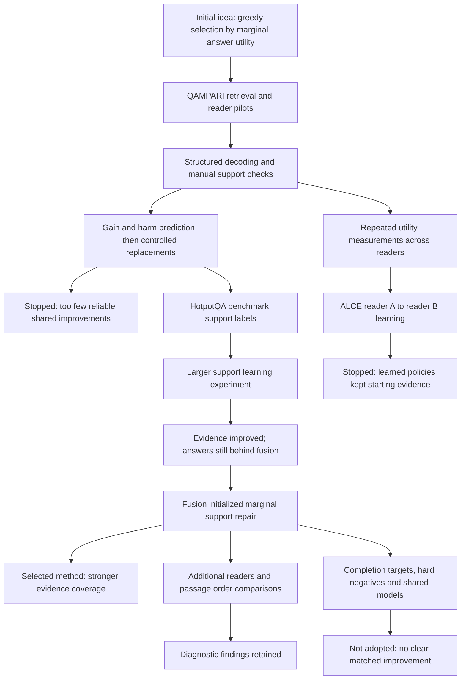

# Evidence Utility Reranking for Grounded Generation

Selecting individually relevant passages can still leave an answer without a necessary fact. This project studies whether a passage selector can improve the evidence already retrieved by predicting what a passage replacement adds and removes.

The final method, **marginal support repair initialized by fusion**, starts with five passages from a fixed pool of 50. A small model considers the incoming passage, the removed passage and the evidence that remains. It makes at most one replacement when the predicted support gain exceeds a validation threshold. Otherwise, it keeps the original set. A replacement preserves five passages and cannot increase the original evidence token budget under either of the two tokenizers.

## Main results

The selector was trained on 512 HotpotQA questions, calibrated on 128 validation questions and evaluated on 128 separate questions. These are research subsets of the public development collection. A complete chain contains every annotated supporting fact needed for a question.

| Selection | Complete evidence chains | Correct answers | Correct answers with complete cited support |
| :--- | :--- | :--- | :--- |
| Fusion | 54 | 39 | 8 |
| Marginal support repair | **67** | **42** | **15** |
| Incoming passage control | 55 | 39 | 10 |
| Relevance selection | 57 | 37 | **15** |
| MMR | 57 | 35 | 14 |

Answer results use the primary Qwen3 8B reader, which passed all 36 qualification checks. Repair recovered 13 complete evidence chains without losing an existing complete chain. Its attributed answer comparison against fusion had nine wins and two losses, with an exact paired p value of 0.0654. The evidence coverage gain is clearer than the answer quality gain; relevance selection ties repair's attributed answer count.

Additional Qwen3 14B and Phi 4 comparisons reuse the same evaluation questions. Their expanded reader checks failed, so those results remain diagnostic. The separate QAMPARI transfer experiment did not improve selection: all three learned policies kept the original evidence, giving reader B utility of 11.30 against 14.21 for MMR.

[Result tables](results/README.md) · [HotpotQA evaluation](experiments/hotpot/README.md) · [QAMPARI transfer](experiments/alce_transfer/README.md)

## Start here

| To understand or reproduce | Open |
| :--- | :--- |
| Final method and worked example | [Methodology](docs/methodology.md) |
| Training and passage selection code | [Method implementation](method/README.md) |
| Explored branches and stopping decisions | [Research history](docs/research_history.md) |
| Closest published methods | [Related work](docs/related_work.md) |
| Installation and complete CPU reproduction route | [Reproduction guide](docs/reproduction.md) |
| Dataset splits, sources and prepared inputs | [Data](data/README.md) |
| Short experiment commands | [Scripts](scripts/README.md) |
| Frozen training and reader settings | [Configurations](configs/README.md) |

## Research journey



The [history table](docs/research_history.md) records all 32 experiment groups. It distinguishes earlier discovery and reused development collections from the final evaluation. The current code package includes the final HotpotQA method and the ALCE transfer replay; earlier branch code is separate from this package.

## Reproduce on CPU

Use Python 3.11 or 3.12. From the repository root in Bash on Linux or WSL:

```bash
python3 -m venv .venv-analysis
source .venv-analysis/bin/activate
python3 -m pip install -r requirements/analysis.txt
python3 scripts/run.py check
```

Restore the prepared inputs from the downloaded data release archives:

```bash
python3 scripts/run.py restore --archives-dir /path/to/release_assets
python3 scripts/run.py restore --archives-dir /path/to/release_assets --groups alce_transfer
```

The four archives total about 212 MB. Allow 2 GiB of free disk space for archives and restored inputs. They preserve the original passage pools, numerical features, annotations and tokenizers, with checksums for every file. See [data preparation](data/README.md) for the published Release download option and source attribution.

Check the saved selector, retrain it, and compare the retrained selections:

```bash
python3 scripts/run.py reproduce
python3 scripts/run.py train
python3 scripts/run.py reproduce --model outputs/repair_model --output outputs/retrained_check.json
```

Training uses benchmark supporting facts as labels and needs no reader calls. The model has 43 input features, 32 hidden units and 1,441 parameters. Full CPU retraining during repository preparation reproduced both saved models' arrays exactly and took about four minutes on that machine.

Recalculate the reported outcomes and export the tables:

```bash
python3 -m experiments.hotpot.evaluate
python3 -m experiments.alce_transfer.evaluate
python3 results/export.py outputs/hotpot_evaluation/results.json \
  outputs/alce_transfer_evaluation/result.json --output outputs/result_tables
```

HotpotQA replay regrades saved answer text and selected evidence. QAMPARI replay reconstructs labels, refits the utility predictors and repeats calibration and comparisons using cached official answer and citation measurements. These commands make no new reader or citation model calls. Fresh reader generation and cluster submission are separate from the CPU replay provided here.

Outputs are written under `outputs/`. Existing results are not overwritten; use a new `--output` path for a repeated run. Experiment specific tests and measured reproduction records are documented in each experiment folder.

## Repository layout

```text
method/        Final selector, saved models and tests
configs/       Training manifest and reader profiles
data/          Split identifiers, checksums and data restoration
experiments/   HotpotQA and QAMPARI evaluation code and saved measurements
scripts/       Commands for checking, restoring, training and selecting
results/       Browsable tables, summaries and table export
docs/          Methodology, research history, related work and reproduction
requirements/  CPU and GPU dependency records
```

Large prepared inputs belong in GitHub Release assets; the local `release_assets/` staging directory is not a source repository folder. Model weights, full retrieval indexes, private review notes and machine configuration are excluded.
