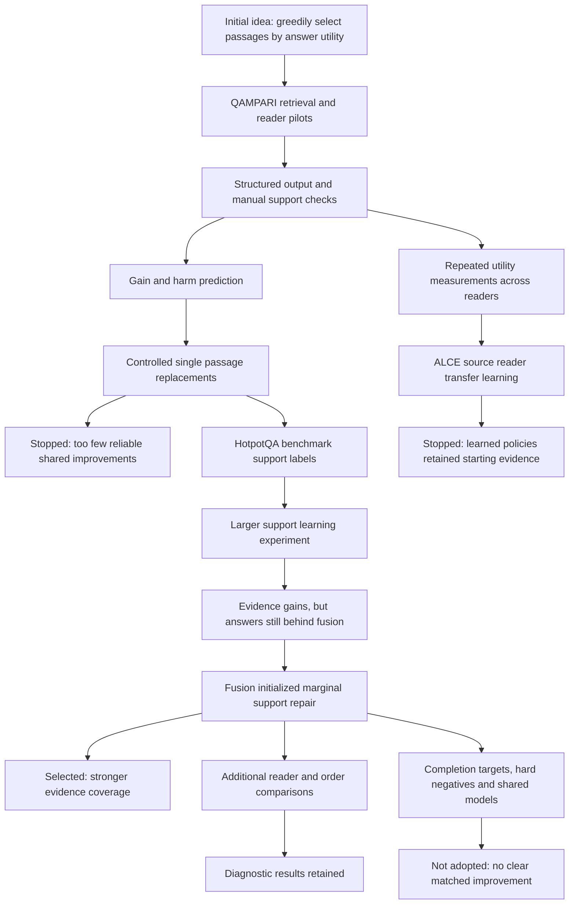

# Research history

The investigation followed two connected questions: how to measure the additional value of evidence, and how to learn useful changes to a selected evidence set. The diagram summarizes the major decisions. The table below preserves the finer branches. Counts from different collections are compared only within their matched experiments.

Earlier discovery and reused development collections are separated from the final evaluation collection below. Runtime failures and reader qualification retries are recorded as such; they are not new methodological results.

| ID | Experiment | Data or setting | Finding and decision |
| :--- | :--- | :--- | :--- |
| B01 | Initial retrieval coverage | 100 QAMPARI discovery questions | Reference assisted selection covers more annotated evidence than fusion and lexical MMR; diagnostic evidence only. |
| B02 | First reader pilot and calibration | Eight QAMPARI questions plus calibration controls | Both small readers fail calibration, preventing use of their outputs as dependable training labels. |
| B03 | Structured answers and support review | Eight QAMPARI questions; 50 assessed records | Output consistency improves, but supported answers are still omitted and citations need manual checks. |
| B04 | Support recovery and released utility selector | Inspected QAMPARI discovery questions | The qualified reader can recover facts already present; this does not necessarily indicate new evidence from the inserted passage. |
| B05 | Second qualified reader replay | Same frozen QAMPARI discovery cases | Many effects become ties across readers; no stronger selector is established. |
| B06 | Discovery expansion | 24 additional QAMPARI questions | Many utility labels are zero; passage position and reader choice change some measured effects. |
| B07 | Automatic gain and harm judge | 20 checked answer transitions | Only six changes match expectations; training stops before fitting a selector. |
| B08 | Revised automatic support judge | 20 development transitions and 65 human support decisions | Development matching rises to 17 of 20, but support decisions agree on only 45 of 65; labels are rejected. |
| B09 | Learning from manually checked transitions | Two training collections and 24 inspected evaluation questions | The joint gain and harm selector trails a simpler model in average answer recall and both trail MMR. |
| B10 | Controlled passage replacements | 20 QAMPARI questions | Two fully resolved questions have a gain without harm, below the planned minimum of five. |
| B11 | Matched reference assisted replacements | 12 QAMPARI questions; four eligible pairs | At most one question can supply a shared strict gain across both readers; the planned minimum is three. |
| B12 | HotpotQA retrieval investigation | 128 questions | Complete support is present in 92 pools; 31 questions expose missing reasoning links in relevance and MMR selections. |
| B13 | HotpotQA reader and prompt checks | Small diagnostic question collection and answer type controls | The calibrated Qwen3 reader passes all 36 checks; the other attempted reader fails an evidence control. |
| B14 | Initial support replacement learners | 127 HotpotQA questions; 36 fits | The primary gain and harm model does not improve over the fixed baselines or simpler control. |
| B15 | Training scale comparison | 512 training, 128 validation and 128 separate questions | The simple support model completes 74 or 75 chains, versus 67 for MMR and 70 for fusion. |
| B16 | Selecting which examples to label | Reused HotpotQA validation questions | The proposed acquisition rule finds more positive labels but does not improve average final coverage over random sampling; costs are simulated. |
| B17 | Reader evaluation of the earlier support model | 128 HotpotQA questions | Attributed answers are 12 for the model, nine for MMR and 15 for fusion, motivating a stronger starting set. |
| B18 | Rank and order based replacement | 14 selected HotpotQA questions and a saved QAMPARI replay | No consistent lower rank replacement gain in both orders; strict order agreement does not improve over the simpler matched filter. |
| B19 | Two simultaneous replacements | 512 training and 128 reused development questions | The interaction model completes 67 chains, versus 67 for single edits and 68 for additive pairs. |
| B20 | Preferences with the same removed passage | 128 reused development questions | The policy gains 12 chains and loses ten; its total of 66 is below the simpler predictor at 70. |
| B21 | Learning to accept proposed replacements | 128 reused development questions | The added acceptance model completes 65 chains, versus 70 for the simple predictor and 66 for fusion. |
| B22 | Original ALCE reader stability | 32 QAMPARI questions, two readers and two random settings | Original insertion effects provide too few informative preferences to pass the stability screen. |
| B23 | Relevance guided insertions and deletions | 32 QAMPARI questions | Deletion gives more useful preferences, but agreement across readers is seven of 11, below the planned threshold. |
| B24 | Fixed answer support under deletion | 32 QAMPARI questions and previously assessed support examples | Support judgments fail the human checks; agreement across readers is three of 14 informative comparisons. |
| B25 | Final fusion initialized repair | 512 training, 128 validation and 128 separate evaluation questions | Complete chains improve from 54 to 67; attributed answers improve from eight to 15 and tie relevance selection. |
| B26 | Additional reader qualification attempts | Same HotpotQA evidence and fixed controls | Several reader variants fail expanded controls and stop before natural answer collection. |
| B27 | Explicit instruction for connecting evidence | 240 reader control generations | A prompt change repairs a few controls but neither reader passes the full qualification checks. |
| B28 | Actual ALCE reader transfer learning | 128 selected training, 40 calibration and 100 evaluation questions | All three learned policies retain the starting evidence. Their combined target reader score is 11.30 versus MMR at 14.21. |
| B29 | Final additional reader and component comparisons | Same final 128 HotpotQA questions; nine arrangements and two readers | Repair improves aggregate attributed counts; expanded controls fail, so results remain diagnostic. Keeping does not improve attributed answers over forced edits. |
| B30 | Whole chain training targets | 416 fitting, 96 calibration and 128 reused development questions | The chosen completion model gives 80 chains versus 78 for the group target, without passing the advancement rule. |
| B31 | Difficult negative training examples | Same development design; three training settings | The proposed sampling gives 76 chains versus 81 for matched resampling. |
| B32 | Shared support and completion model | Same development design; nine new fits | The shared model gives 77 chains versus 78 for its same size control; separate prediction averaging gives 81, tying resampled support alone. |

The final HotpotQA and ALCE transfer replays are available under `experiments/`. The remaining entries document the completed investigation; their earlier source folders are not part of the current upload batch. The report appendices retain the original experiment record paths.
